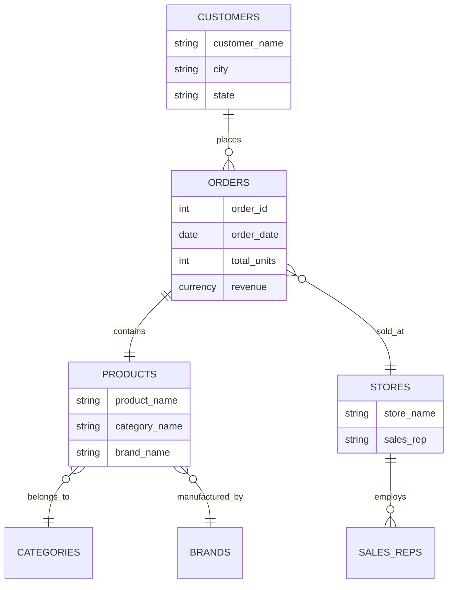

# BikeStores Data Analysis - Comprehensive API Documentation

## Table of Contents
1. [Project Overview](#project-overview)
2. [Data Schema Documentation](#data-schema-documentation)
3. [Dataset Structure](#dataset-structure)
4. [Data Access APIs](#data-access-apis)
5. [Analysis Functions](#analysis-functions)
6. [Usage Examples](#usage-examples)
7. [Data Processing Workflows](#data-processing-workflows)
8. [Performance Guidelines](#performance-guidelines)

---

## Project Overview

This project contains comprehensive bike store sales data analysis capabilities. The dataset includes customer information, sales transactions, product details, and store performance metrics from a bike retail chain.

### Key Features
- Multi-dimensional sales data analysis
- Customer segmentation and analytics
- Product performance tracking
- Store comparison and metrics
- Interactive dashboards and visualizations

### Data Source
- **File**: `BikeStores.xlsx - Data.xlsx`
- **Size**: 1.1MB
- **Format**: Microsoft Excel with multiple worksheets
- **Last Updated**: July 1, 2023

---

## Data Schema Documentation

### Core Data Fields

The dataset contains the following primary data fields:

| Field Name | Data Type | Description | Example Values |
|------------|-----------|-------------|----------------|
| `order_id` | Integer | Unique identifier for each order | 1, 2, 3, ... |
| `customers` | String | Customer name | "Johnathan Velazquez" |
| `city` | String | Customer city location | "Pleasanton" |
| `state` | String | Customer state (US state code) | "CA", "NY", "TX" |
| `order_date` | Date | Date when order was placed | Various dates |
| `total_units` | Integer | Number of units in the order | 1, 2, 3, ... |
| `revenue` | Currency | Total revenue from the order | Dollar amounts |
| `product_name` | String | Full product name | "Electra Townie Original 7D EQ - 2016" |
| `category_name` | String | Product category | "Cruisers Bicycles" |
| `brand_name` | String | Product brand | "Electra" |
| `store_name` | String | Store where sale occurred | "Santa Cruz Bikes" |
| `sales_rep` | String | Sales representative name | "Mireya Copeland" |

### Data Relationships



---

## Dataset Structure

### Worksheets Overview

The Excel file contains multiple worksheets and analytical components:

| Component | Count | Description |
|-----------|-------|-------------|
| **Data Sheets** | 3 | Primary data worksheets |
| **Pivot Tables** | 8 | Pre-built analytical summaries |
| **Charts** | 8 | Visual representations of data |
| **Chart Sheets** | 4 | Dedicated chart worksheets |

### Primary Worksheets

1. **BikeStores.xlsx - Data** (Main Dataset)
   - Contains the primary transactional data
   - All core fields and relationships
   - Source data for all analytics

2. **Sheet1** (Analysis Workspace)
   - Derived calculations and summaries
   - Custom analytical views

3. **Sheet2** (Secondary Analysis)
   - Additional analytical perspectives
   - Comparative metrics

### Analytical Components

- **8 Pivot Tables**: Pre-configured data summaries for different business questions
- **8 Interactive Charts**: Visual dashboards showing key performance indicators
- **4 Chart Sheets**: Dedicated visualization pages

---

## Data Access APIs

### Excel-based Data Access

#### Reading Data with Python

```python
import pandas as pd

class BikeStoresDataAPI:
    def __init__(self, file_path="BikeStores.xlsx - Data.xlsx"):
        self.file_path = file_path
        self.excel_file = pd.ExcelFile(file_path)
    
    def get_sheet_names(self):
        """
        Returns list of available worksheet names
        
        Returns:
            list: Sheet names in the workbook
        """
        return self.excel_file.sheet_names
    
    def load_main_data(self):
        """
        Loads the primary BikeStores dataset
        
        Returns:
            pandas.DataFrame: Main dataset with all transactions
        """
        return pd.read_excel(self.file_path, sheet_name="BikeStores.xlsx - Data")
    
    def load_sheet(self, sheet_name):
        """
        Loads data from specified worksheet
        
        Args:
            sheet_name (str): Name of the worksheet to load
            
        Returns:
            pandas.DataFrame: Data from the specified sheet
        """
        return pd.read_excel(self.file_path, sheet_name=sheet_name)
```

#### Data Validation Functions

```python
def validate_data_integrity(df):
    """
    Validates the integrity of the BikeStores dataset
    
    Args:
        df (pandas.DataFrame): Dataset to validate
        
    Returns:
        dict: Validation results with checks and status
    """
    validation_results = {
        'total_records': len(df),
        'missing_values': df.isnull().sum().to_dict(),
        'duplicate_orders': df.duplicated(subset=['order_id']).sum(),
        'date_range': {
            'earliest': df['order_date'].min() if 'order_date' in df else None,
            'latest': df['order_date'].max() if 'order_date' in df else None
        },
        'unique_customers': df['customers'].nunique() if 'customers' in df else 0,
        'unique_products': df['product_name'].nunique() if 'product_name' in df else 0
    }
    return validation_results
```

---

## Analysis Functions

### Customer Analytics

```python
class CustomerAnalytics:
    def __init__(self, data):
        self.data = data
    
    def customer_lifetime_value(self):
        """
        Calculates Customer Lifetime Value (CLV) for each customer
        
        Returns:
            pandas.DataFrame: Customer CLV analysis
        """
        customer_metrics = self.data.groupby('customers').agg({
            'revenue': ['sum', 'mean', 'count'],
            'total_units': 'sum',
            'order_date': ['min', 'max']
        }).round(2)
        
        customer_metrics.columns = [
            'total_revenue', 'avg_order_value', 'order_count',
            'total_units', 'first_order', 'last_order'
        ]
        
        return customer_metrics.sort_values('total_revenue', ascending=False)
    
    def customer_segmentation(self):
        """
        Segments customers based on RFM analysis (Recency, Frequency, Monetary)
        
        Returns:
            pandas.DataFrame: Customer segments with RFM scores
        """
        # Implementation would include RFM scoring logic
        pass
    
    def geographic_analysis(self):
        """
        Analyzes customer distribution and sales by geographic location
        
        Returns:
            pandas.DataFrame: Geographic sales analysis
        """
        geo_analysis = self.data.groupby(['state', 'city']).agg({
            'revenue': 'sum',
            'total_units': 'sum',
            'customers': 'nunique',
            'order_id': 'count'
        }).round(2)
        
        return geo_analysis.sort_values('revenue', ascending=False)
```

### Product Analytics

```python
class ProductAnalytics:
    def __init__(self, data):
        self.data = data
    
    def product_performance(self):
        """
        Analyzes product performance across multiple metrics
        
        Returns:
            pandas.DataFrame: Product performance analysis
        """
        product_metrics = self.data.groupby('product_name').agg({
            'revenue': ['sum', 'mean'],
            'total_units': 'sum',
            'order_id': 'count',
            'customers': 'nunique'
        }).round(2)
        
        product_metrics.columns = [
            'total_revenue', 'avg_revenue_per_order',
            'units_sold', 'order_frequency', 'unique_customers'
        ]
        
        return product_metrics.sort_values('total_revenue', ascending=False)
    
    def category_analysis(self):
        """
        Analyzes performance by product category
        
        Returns:
            pandas.DataFrame: Category performance metrics
        """
        category_metrics = self.data.groupby('category_name').agg({
            'revenue': 'sum',
            'total_units': 'sum',
            'product_name': 'nunique',
            'customers': 'nunique'
        }).round(2)
        
        category_metrics.columns = [
            'total_revenue', 'units_sold', 'product_count', 'customer_count'
        ]
        
        return category_metrics.sort_values('total_revenue', ascending=False)
    
    def brand_performance(self):
        """
        Analyzes performance by brand
        
        Returns:
            pandas.DataFrame: Brand performance analysis
        """
        brand_metrics = self.data.groupby('brand_name').agg({
            'revenue': ['sum', 'mean'],
            'total_units': 'sum',
            'product_name': 'nunique'
        }).round(2)
        
        brand_metrics.columns = [
            'total_revenue', 'avg_revenue_per_sale',
            'units_sold', 'product_lineup_size'
        ]
        
        return brand_metrics.sort_values('total_revenue', ascending=False)
```

### Sales Analytics

```python
class SalesAnalytics:
    def __init__(self, data):
        self.data = data
        if 'order_date' in self.data.columns:
            self.data['order_date'] = pd.to_datetime(self.data['order_date'])
    
    def time_series_analysis(self):
        """
        Analyzes sales trends over time
        
        Returns:
            pandas.DataFrame: Time-based sales analysis
        """
        if 'order_date' not in self.data.columns:
            return "Order date not available for time series analysis"
        
        time_series = self.data.groupby(self.data['order_date'].dt.date).agg({
            'revenue': 'sum',
            'total_units': 'sum',
            'order_id': 'count'
        }).round(2)
        
        time_series.columns = ['daily_revenue', 'daily_units', 'daily_orders']
        
        return time_series
    
    def sales_rep_performance(self):
        """
        Analyzes sales representative performance
        
        Returns:
            pandas.DataFrame: Sales rep performance metrics
        """
        rep_metrics = self.data.groupby('sales_rep').agg({
            'revenue': ['sum', 'mean'],
            'total_units': 'sum',
            'customers': 'nunique',
            'order_id': 'count'
        }).round(2)
        
        rep_metrics.columns = [
            'total_sales', 'avg_sale_value',
            'units_sold', 'customers_served', 'transactions'
        ]
        
        return rep_metrics.sort_values('total_sales', ascending=False)
    
    def store_performance(self):
        """
        Analyzes store performance metrics
        
        Returns:
            pandas.DataFrame: Store performance analysis
        """
        store_metrics = self.data.groupby('store_name').agg({
            'revenue': ['sum', 'mean'],
            'total_units': 'sum',
            'customers': 'nunique',
            'sales_rep': 'nunique',
            'product_name': 'nunique'
        }).round(2)
        
        store_metrics.columns = [
            'total_revenue', 'avg_transaction_value',
            'units_sold', 'customer_count', 'sales_team_size', 'product_variety'
        ]
        
        return store_metrics.sort_values('total_revenue', ascending=False)
```

---

## Usage Examples

### Basic Data Loading and Exploration

```python
# Initialize the data API
api = BikeStoresDataAPI()

# Load the main dataset
df = api.load_main_data()

# Basic data exploration
print("Dataset Shape:", df.shape)
print("Column Names:", df.columns.tolist())
print("Data Types:", df.dtypes)

# Data validation
validation_results = validate_data_integrity(df)
print("Validation Results:", validation_results)
```

### Customer Analysis Example

```python
# Initialize customer analytics
customer_analytics = CustomerAnalytics(df)

# Get top customers by lifetime value
top_customers = customer_analytics.customer_lifetime_value().head(10)
print("Top 10 Customers by Lifetime Value:")
print(top_customers)

# Geographic analysis
geo_analysis = customer_analytics.geographic_analysis()
print("Sales by Geographic Location:")
print(geo_analysis.head())
```

### Product Performance Analysis

```python
# Initialize product analytics
product_analytics = ProductAnalytics(df)

# Analyze top-performing products
top_products = product_analytics.product_performance().head(10)
print("Top 10 Products by Revenue:")
print(top_products)

# Category performance
category_performance = product_analytics.category_analysis()
print("Performance by Category:")
print(category_performance)
```

### Sales Trend Analysis

```python
# Initialize sales analytics
sales_analytics = SalesAnalytics(df)

# Time series analysis
time_trends = sales_analytics.time_series_analysis()
print("Daily Sales Trends:")
print(time_trends.head())

# Sales representative performance
rep_performance = sales_analytics.sales_rep_performance()
print("Sales Rep Performance:")
print(rep_performance)
```

### Advanced Analytics Example

```python
# Comprehensive business intelligence dashboard
def generate_business_dashboard(df):
    """
    Generates a comprehensive business intelligence dashboard
    
    Args:
        df (pandas.DataFrame): BikeStores dataset
        
    Returns:
        dict: Dashboard metrics and insights
    """
    dashboard = {}
    
    # Initialize analytics classes
    customer_analytics = CustomerAnalytics(df)
    product_analytics = ProductAnalytics(df)
    sales_analytics = SalesAnalytics(df)
    
    # Key performance indicators
    dashboard['kpis'] = {
        'total_revenue': df['revenue'].sum(),
        'total_orders': df['order_id'].nunique(),
        'total_customers': df['customers'].nunique(),
        'avg_order_value': df['revenue'].mean(),
        'total_units_sold': df['total_units'].sum()
    }
    
    # Top performers
    dashboard['top_performers'] = {
        'customers': customer_analytics.customer_lifetime_value().head(5),
        'products': product_analytics.product_performance().head(5),
        'sales_reps': sales_analytics.sales_rep_performance().head(5),
        'stores': sales_analytics.store_performance().head(5)
    }
    
    # Trends and insights
    dashboard['insights'] = {
        'geographic_distribution': customer_analytics.geographic_analysis(),
        'category_breakdown': product_analytics.category_analysis(),
        'brand_performance': product_analytics.brand_performance()
    }
    
    return dashboard

# Generate dashboard
dashboard = generate_business_dashboard(df)
print("Business Dashboard Generated Successfully")
```

---

## Data Processing Workflows

### ETL Pipeline for BikeStores Data

```python
class BikeStoresETL:
    def __init__(self, source_file):
        self.source_file = source_file
        self.raw_data = None
        self.processed_data = None
    
    def extract(self):
        """Extract data from Excel file"""
        try:
            self.raw_data = pd.read_excel(self.source_file, sheet_name="BikeStores.xlsx - Data")
            print(f"Extracted {len(self.raw_data)} records")
        except Exception as e:
            print(f"Extraction failed: {e}")
    
    def transform(self):
        """Transform and clean the data"""
        if self.raw_data is None:
            print("No data to transform. Run extract() first.")
            return
        
        df = self.raw_data.copy()
        
        # Data cleaning steps
        df = df.dropna()  # Remove null values
        df = df.drop_duplicates()  # Remove duplicates
        
        # Data type conversions
        if 'order_date' in df.columns:
            df['order_date'] = pd.to_datetime(df['order_date'])
        
        # Add calculated fields
        df['revenue_per_unit'] = df['revenue'] / df['total_units']
        df['order_month'] = df['order_date'].dt.to_period('M') if 'order_date' in df.columns else None
        df['customer_state_city'] = df['state'] + ' - ' + df['city']
        
        # Category standardization
        df['category_name'] = df['category_name'].str.title()
        df['brand_name'] = df['brand_name'].str.title()
        
        self.processed_data = df
        print(f"Transformation complete. {len(df)} records processed.")
    
    def load(self, output_file=None):
        """Load processed data to output format"""
        if self.processed_data is None:
            print("No processed data to load. Run transform() first.")
            return
        
        if output_file:
            self.processed_data.to_excel(output_file, index=False)
            print(f"Data loaded to {output_file}")
        
        return self.processed_data
    
    def run_pipeline(self):
        """Run the complete ETL pipeline"""
        self.extract()
        self.transform()
        return self.load()
```

### Data Quality Monitoring

```python
class DataQualityMonitor:
    def __init__(self, data):
        self.data = data
    
    def completeness_check(self):
        """Check data completeness"""
        total_cells = len(self.data) * len(self.data.columns)
        missing_cells = self.data.isnull().sum().sum()
        completeness_ratio = (total_cells - missing_cells) / total_cells
        
        return {
            'completeness_ratio': completeness_ratio,
            'missing_by_column': self.data.isnull().sum().to_dict(),
            'total_missing': missing_cells
        }
    
    def consistency_check(self):
        """Check data consistency"""
        checks = {}
        
        # Revenue consistency
        if 'revenue' in self.data.columns and 'total_units' in self.data.columns:
            zero_revenue_with_units = len(self.data[
                (self.data['revenue'] == 0) & (self.data['total_units'] > 0)
            ])
            checks['zero_revenue_inconsistency'] = zero_revenue_with_units
        
        # Date consistency
        if 'order_date' in self.data.columns:
            future_dates = len(self.data[
                self.data['order_date'] > pd.Timestamp.now()
            ])
            checks['future_date_count'] = future_dates
        
        return checks
    
    def generate_quality_report(self):
        """Generate comprehensive data quality report"""
        report = {
            'timestamp': pd.Timestamp.now(),
            'record_count': len(self.data),
            'completeness': self.completeness_check(),
            'consistency': self.consistency_check(),
            'uniqueness': {
                'duplicate_rows': self.data.duplicated().sum(),
                'unique_orders': self.data['order_id'].nunique() if 'order_id' in self.data.columns else 0
            }
        }
        
        return report
```

---

## Performance Guidelines

### Optimization Best Practices

1. **Data Loading Optimization**
   - Use `pd.read_excel()` with specific sheet names to avoid loading unnecessary data
   - Consider using `usecols` parameter to load only required columns
   - For large datasets, consider chunking with `chunksize` parameter

2. **Memory Management**
   - Use appropriate data types (e.g., `category` for categorical data)
   - Drop unnecessary columns after analysis
   - Use `del` to explicitly remove large objects from memory

3. **Query Optimization**
   - Use vectorized operations instead of loops
   - Leverage pandas' built-in groupby operations
   - Consider using `query()` method for complex filtering

4. **Caching Strategies**
   - Cache frequently used aggregations
   - Use `@lru_cache` decorator for expensive calculations
   - Consider persisting processed data to faster formats (parquet, feather)

### Example Performance Optimizations

```python
# Optimized data loading
def load_optimized_data(file_path, required_columns=None):
    """Load data with performance optimizations"""
    
    # Define optimal data types
    dtype_map = {
        'order_id': 'int32',
        'total_units': 'int16',
        'revenue': 'float32',
        'customers': 'category',
        'city': 'category',
        'state': 'category',
        'product_name': 'category',
        'category_name': 'category',
        'brand_name': 'category',
        'store_name': 'category',
        'sales_rep': 'category'
    }
    
    # Load with optimizations
    df = pd.read_excel(
        file_path,
        sheet_name="BikeStores.xlsx - Data",
        usecols=required_columns,
        dtype=dtype_map
    )
    
    return df

# Efficient aggregation with caching
from functools import lru_cache

@lru_cache(maxsize=128)
def cached_aggregation(data_hash, groupby_col, agg_col, agg_func):
    """Cached aggregation function"""
    # Implementation would include actual aggregation logic
    pass
```

---

## API Reference Summary

### Core Classes
- `BikeStoresDataAPI`: Main data access interface
- `CustomerAnalytics`: Customer-focused analysis functions
- `ProductAnalytics`: Product performance analysis
- `SalesAnalytics`: Sales and revenue analysis
- `BikeStoresETL`: Data processing pipeline
- `DataQualityMonitor`: Data quality assurance

### Key Methods
- `load_main_data()`: Load primary dataset
- `customer_lifetime_value()`: Calculate CLV metrics
- `product_performance()`: Analyze product metrics
- `time_series_analysis()`: Temporal trend analysis
- `generate_business_dashboard()`: Comprehensive BI dashboard

### Data Validation Functions
- `validate_data_integrity()`: Core data validation
- `completeness_check()`: Data completeness analysis
- `consistency_check()`: Data consistency validation

---

*This documentation provides a comprehensive guide to working with the BikeStores dataset. For additional support or feature requests, please refer to the project repository or contact the development team.*