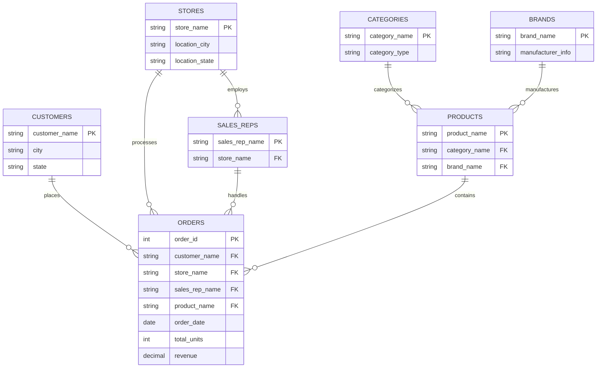
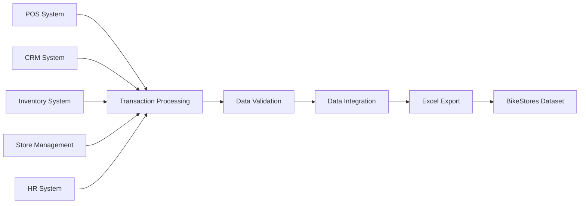

# BikeStores Dataset - Data Schema Documentation

## Overview

This document provides a comprehensive description of the BikeStores dataset schema, including data types, constraints, relationships, and business rules.

## Dataset Information

- **Name**: BikeStores Retail Sales Data
- **Format**: Microsoft Excel (.xlsx)
- **Size**: 1.1MB
- **Source File**: `BikeStores.xlsx - Data.xlsx`
- **Primary Sheet**: `BikeStores.xlsx - Data`
- **Last Updated**: July 1, 2023

## Table Structure

### Primary Data Table: BikeStores Sales Transactions

| Column Name | Data Type | Nullable | Description | Example Values | Business Rules |
|-------------|-----------|----------|-------------|----------------|----------------|
| `order_id` | INTEGER | No | Unique identifier for each order transaction | 1, 2, 3, 4... | Primary key, auto-incrementing |
| `customers` | VARCHAR(255) | No | Full name of the customer | "Johnathan Velazquez", "Mireya Copeland" | Full customer name as recorded |
| `city` | VARCHAR(100) | No | Customer's city of residence | "Pleasanton", "Santa Cruz", "Baldwin" | Geographic location |
| `state` | VARCHAR(2) | No | US state code (two-letter abbreviation) | "CA", "NY", "TX" | Valid US state codes only |
| `order_date` | DATE | No | Date when the order was placed | 2016-01-01, 2017-12-25 | Valid dates within business period |
| `total_units` | INTEGER | No | Number of units purchased in the order | 1, 2, 3, 5 | Must be positive integer ≥ 1 |
| `revenue` | DECIMAL(10,2) | No | Total revenue amount for the order | 269.99, 1499.99, 539.99 | Currency amount in USD |
| `product_name` | VARCHAR(500) | No | Complete product name and model | "Electra Townie Original 7D EQ - 2016" | Full product description |
| `category_name` | VARCHAR(100) | No | Product category classification | "Cruisers Bicycles", "Mountain Bikes" | Standardized category names |
| `brand_name` | VARCHAR(100) | No | Product brand/manufacturer | "Electra", "Trek", "Specialized" | Brand as registered by manufacturer |
| `store_name` | VARCHAR(200) | No | Name of the retail store | "Santa Cruz Bikes", "Baldwin Bikes" | Official store name |
| `sales_rep` | VARCHAR(255) | No | Sales representative name | "Mireya Copeland", "Venita Daniel" | Employee who handled the sale |

## Data Relationships

### Entity Relationship Diagram



### Relationship Descriptions

1. **Customer → Orders**: One customer can place multiple orders (1:M)
2. **Store → Orders**: One store can process multiple orders (1:M)
3. **Sales Rep → Orders**: One sales rep can handle multiple orders (1:M)
4. **Product → Orders**: One product can appear in multiple orders (1:M)
5. **Category → Products**: One category contains multiple products (1:M)
6. **Brand → Products**: One brand manufactures multiple products (1:M)
7. **Store → Sales Reps**: One store employs multiple sales reps (1:M)

## Data Quality Constraints

### Primary Key Constraints
- `order_id`: Must be unique across all records
- No duplicate combinations of all fields should exist

### Foreign Key Constraints
- `customers`: Must exist in customer master list
- `product_name`: Must exist in product catalog
- `store_name`: Must exist in store directory
- `sales_rep`: Must be associated with the specified store

### Business Rules
1. **Revenue Calculation**: `revenue = unit_price × total_units`
2. **Date Constraints**: `order_date` must be within operational business period
3. **Geographic Constraints**: `state` must be valid US state code
4. **Quantity Constraints**: `total_units` must be positive integer
5. **Revenue Constraints**: `revenue` must be positive decimal value

## Data Domains and Valid Values

### Geographic Data
- **States**: Limited to US states where business operates
- **Cities**: Must correspond to valid cities within the specified state
- **Store Locations**: Stores must have valid geographic addresses

### Product Data
- **Categories**: Standardized product category taxonomy
- **Brands**: Authorized brand partnerships only
- **Product Names**: Follow standardized naming convention

### Transaction Data
- **Order IDs**: Sequential numbering system
- **Dates**: Within business operational timeframe
- **Currency**: All amounts in USD

## Data Types and Formats

### String Fields
```sql
customers: VARCHAR(255) -- Full customer name
city: VARCHAR(100) -- City name
state: CHAR(2) -- Two-letter state code
product_name: VARCHAR(500) -- Complete product description
category_name: VARCHAR(100) -- Product category
brand_name: VARCHAR(100) -- Brand name
store_name: VARCHAR(200) -- Store name
sales_rep: VARCHAR(255) -- Sales representative name
```

### Numeric Fields
```sql
order_id: INTEGER -- Unique order identifier
total_units: INTEGER -- Quantity purchased
revenue: DECIMAL(10,2) -- Revenue amount in USD
```

### Date Fields
```sql
order_date: DATE -- Order placement date (YYYY-MM-DD)
```

## Sample Data Examples

### Valid Records
```json
{
  "order_id": 1,
  "customers": "Johnathan Velazquez",
  "city": "Pleasanton",
  "state": "CA",
  "order_date": "2016-01-01",
  "total_units": 1,
  "revenue": 269.99,
  "product_name": "Electra Townie Original 7D EQ - 2016",
  "category_name": "Cruisers Bicycles",
  "brand_name": "Electra",
  "store_name": "Santa Cruz Bikes",
  "sales_rep": "Mireya Copeland"
}
```

### Data Validation Rules

#### Customer Data Validation
```python
def validate_customer_data(record):
    """Validate customer-related fields"""
    validations = {
        'customer_name_not_empty': len(record['customers'].strip()) > 0,
        'city_not_empty': len(record['city'].strip()) > 0,
        'state_valid_format': len(record['state']) == 2 and record['state'].isupper(),
        'state_valid_code': record['state'] in VALID_US_STATES
    }
    return validations
```

#### Product Data Validation
```python
def validate_product_data(record):
    """Validate product-related fields"""
    validations = {
        'product_name_not_empty': len(record['product_name'].strip()) > 0,
        'category_valid': record['category_name'] in VALID_CATEGORIES,
        'brand_valid': record['brand_name'] in VALID_BRANDS
    }
    return validations
```

#### Transaction Data Validation
```python
def validate_transaction_data(record):
    """Validate transaction-related fields"""
    validations = {
        'order_id_positive': record['order_id'] > 0,
        'units_positive': record['total_units'] > 0,
        'revenue_positive': record['revenue'] > 0,
        'date_valid': validate_date_format(record['order_date']),
        'revenue_units_consistent': record['revenue'] > 0 if record['total_units'] > 0 else True
    }
    return validations
```

## Data Quality Metrics

### Completeness Metrics
- **Required Fields**: All fields are mandatory (0% null tolerance)
- **Data Coverage**: 100% populated fields expected
- **Missing Value Check**: No NULL or empty values allowed

### Consistency Metrics
- **Date Format**: Consistent YYYY-MM-DD format
- **State Codes**: Standardized two-letter uppercase format
- **Currency Format**: Consistent decimal precision (2 places)
- **Name Formats**: Consistent capitalization and formatting

### Accuracy Metrics
- **Geographic Accuracy**: Valid state-city combinations
- **Product Accuracy**: Valid product-category-brand relationships
- **Financial Accuracy**: Revenue calculations match unit prices
- **Temporal Accuracy**: Dates within valid business periods

## Data Lineage and Source Information

### Data Sources
1. **Customer Database**: CRM system customer records
2. **Product Catalog**: Inventory management system
3. **Sales Transactions**: Point-of-sale (POS) system
4. **Store Information**: Store management system
5. **Employee Records**: HR system for sales rep information

### Data Processing Pipeline


## Data Dictionary

### Business Glossary
- **Order**: A single purchase transaction by a customer
- **Customer**: Individual who purchases products from stores
- **Product**: Bicycle or related merchandise sold by stores
- **Category**: Product classification for inventory management
- **Brand**: Manufacturer or trademark of products
- **Store**: Physical retail location
- **Sales Rep**: Employee responsible for customer sales
- **Revenue**: Total monetary value of a transaction
- **Units**: Quantity of products purchased

### Technical Terms
- **Primary Key**: Unique identifier for each record
- **Foreign Key**: Reference to related entity
- **Cardinality**: Relationship multiplicity between entities
- **Normalization**: Data structure optimization
- **Referential Integrity**: Maintaining valid relationships

## Usage Guidelines

### Data Access Patterns
1. **Analytical Queries**: Focus on aggregations and summaries
2. **Transactional Queries**: Individual order lookups
3. **Reporting Queries**: Time-based and dimensional analysis
4. **Data Mining**: Pattern discovery and segmentation

### Performance Considerations
1. **Indexing**: Create indexes on frequently queried fields
2. **Partitioning**: Consider date-based partitioning for large datasets
3. **Caching**: Cache frequently accessed aggregations
4. **Query Optimization**: Use appropriate WHERE clauses

### Security and Privacy
1. **Customer Data**: Treat customer names as personally identifiable information (PII)
2. **Sales Data**: Sensitive business information requiring access controls
3. **Employee Data**: Sales rep information subject to HR policies
4. **Compliance**: Ensure adherence to data protection regulations

## Change Management

### Schema Evolution
- **Version Control**: Track schema changes with version numbers
- **Backward Compatibility**: Maintain compatibility with existing applications
- **Migration Scripts**: Provide scripts for schema updates
- **Documentation Updates**: Keep documentation synchronized with changes

### Data Maintenance
- **Regular Validation**: Implement automated data quality checks
- **Cleanup Procedures**: Remove or correct invalid records
- **Backup Procedures**: Maintain regular data backups
- **Recovery Plans**: Document data recovery procedures

---

*This schema documentation provides the foundation for understanding and working with the BikeStores dataset. For implementation details and usage examples, refer to the [API Documentation](API_DOCUMENTATION.md) and [Quick Start Guide](QUICK_START_GUIDE.md).*