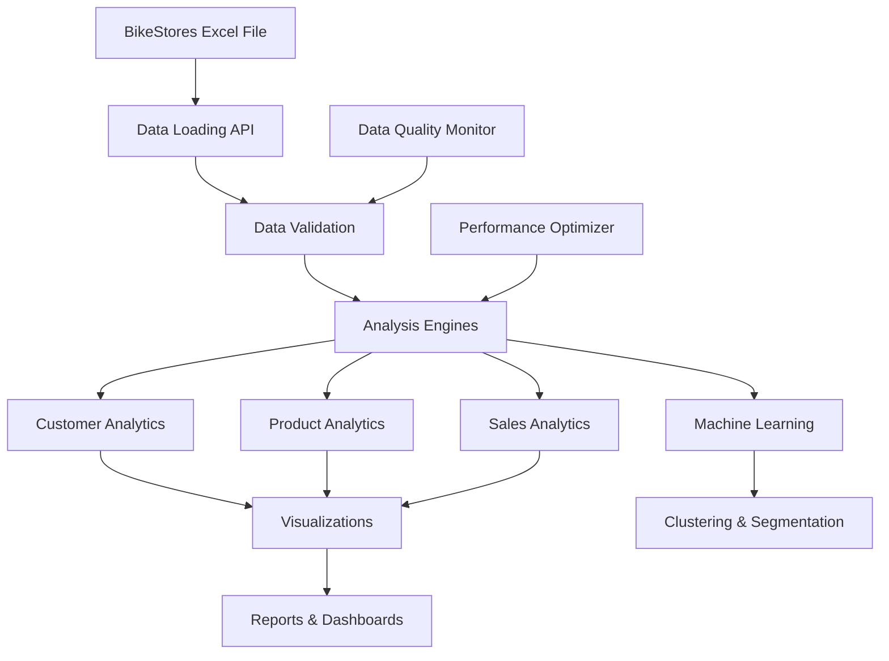

# BikeStores Data Analysis Project

## 🚴‍♂️ Overview

This project provides comprehensive data analysis capabilities for the BikeStores retail dataset. It includes a complete suite of analytical tools, APIs, and documentation for exploring sales data, customer behavior, product performance, and business intelligence insights.

The BikeStores dataset contains real-world retail transaction data from a bike store chain, including customer information, product sales, geographic data, and sales representative performance metrics.

## 📊 Dataset Summary

- **File**: `BikeStores.xlsx - Data.xlsx` (1.1MB)
- **Records**: Comprehensive sales transaction data
- **Time Period**: Multi-year sales history
- **Data Points**: 12 core fields covering customers, products, sales, and geography
- **Structure**: 3 worksheets + 8 pivot tables + 8 charts + analytical components

### Key Data Fields
- Customer information (name, location)
- Product details (name, category, brand)
- Sales transactions (revenue, units, dates)
- Store and sales rep data
- Geographic distribution

## 🚀 Quick Start

### Installation

```bash
# Install required Python packages
pip install pandas openpyxl xlrd matplotlib seaborn plotly scikit-learn

# Or using conda
conda install pandas openpyxl xlrd matplotlib seaborn plotly scikit-learn
```

### Basic Usage

```python
import pandas as pd

# Load the dataset
df = pd.read_excel("BikeStores.xlsx - Data.xlsx", sheet_name="BikeStores.xlsx - Data")

# Quick overview
print(f"Dataset shape: {df.shape}")
print(f"Total revenue: ${df['revenue'].sum():,.2f}")
print(f"Unique customers: {df['customers'].nunique():,}")

# Top customers by revenue
top_customers = df.groupby('customers')['revenue'].sum().sort_values(ascending=False).head()
print("Top 5 Customers:")
print(top_customers)
```

## 📚 Documentation

This project includes comprehensive documentation covering all aspects of data analysis:

### Core Documentation Files

| Document | Description | Best For |
|----------|-------------|----------|
| **[API Documentation](API_DOCUMENTATION.md)** | Complete API reference with classes, methods, and functions | Developers, Advanced Users |
| **[Quick Start Guide](QUICK_START_GUIDE.md)** | Step-by-step tutorial for beginners | New Users, Getting Started |
| **[Examples & Use Cases](EXAMPLES.md)** | Comprehensive examples with real-world scenarios | All Users, Learning |
| **[Data Schema](DATA_SCHEMA.md)** | Detailed data structure and relationships | Data Engineers, Analysts |

### What's Included

#### 🔧 API Documentation
- **Complete Class Reference**: `BikeStoresDataAPI`, `CustomerAnalytics`, `ProductAnalytics`, `SalesAnalytics`
- **Data Processing Pipeline**: ETL workflows and data quality monitoring
- **Performance Optimization**: Best practices and performance guidelines
- **Validation Functions**: Data integrity and quality assurance tools

#### 📖 Quick Start Guide
- **5-Minute Tutorial**: Get up and running immediately
- **Common Use Cases**: Customer analysis, product performance, sales trends
- **Visualization Examples**: Charts, dashboards, and reports
- **Troubleshooting**: Common issues and solutions

#### 💡 Examples & Use Cases
- **10 Comprehensive Examples**: From basic analytics to machine learning
- **Business Intelligence Scenarios**: Executive dashboards and KPIs
- **Advanced Analytics**: Customer segmentation, RFM analysis, clustering
- **Visualization Suite**: Static and interactive charts with Matplotlib and Plotly
- **Automation Workflows**: Scheduled reporting and pipeline automation

#### 📋 Data Schema Documentation
- **Complete Field Reference**: All 12 data fields with types and constraints
- **Relationship Diagrams**: Entity relationships and data flow
- **Validation Rules**: Data quality constraints and business rules
- **Usage Guidelines**: Best practices for data access and security

## 🎯 Key Features

### 📈 Analytics Capabilities
- **Customer Analytics**: Lifetime value, segmentation, geographic analysis
- **Product Analytics**: Performance metrics, category analysis, cross-selling insights
- **Sales Analytics**: Trend analysis, rep performance, store comparisons
- **Time Series Analysis**: Temporal patterns and seasonal trends

### 🤖 Machine Learning Ready
- **Customer Segmentation**: RFM analysis and K-means clustering
- **Predictive Modeling**: Sales forecasting capabilities
- **Market Basket Analysis**: Product association rules
- **Feature Engineering**: Automated feature creation

### 📊 Visualization & Reporting
- **Static Dashboards**: Matplotlib and Seaborn visualizations
- **Interactive Dashboards**: Plotly-powered interactive charts
- **Automated Reports**: Excel export with multiple worksheets
- **Executive Summaries**: KPI dashboards and business metrics

### ⚡ Performance Optimized
- **Efficient Data Loading**: Optimized pandas operations
- **Memory Management**: Large dataset handling strategies
- **Caching Support**: Frequently used calculation caching
- **Parallel Processing**: Multi-core computation support

## 🏗️ Architecture



## 📦 Project Structure

```
BikeStores-Analysis/
├── BikeStores.xlsx - Data.xlsx     # Main dataset
├── README.md                       # This file
├── API_DOCUMENTATION.md            # Complete API reference
├── QUICK_START_GUIDE.md           # Beginner tutorial
├── EXAMPLES.md                     # Comprehensive examples
├── DATA_SCHEMA.md                 # Data structure documentation
└── AboutME.md                     # Project author information
```

## 🎮 Usage Examples

### Customer Lifetime Value Analysis
```python
from datetime import datetime
import pandas as pd

# Load and analyze customer data
df = pd.read_excel("BikeStores.xlsx - Data.xlsx", sheet_name="BikeStores.xlsx - Data")

# Calculate customer metrics
customer_clv = df.groupby('customers').agg({
    'revenue': ['sum', 'mean', 'count'],
    'total_units': 'sum',
    'order_date': ['min', 'max']
}).round(2)

customer_clv.columns = ['total_revenue', 'avg_order_value', 'order_count', 'total_units', 'first_order', 'last_order']

# Top 10 customers by lifetime value
top_customers = customer_clv.sort_values('total_revenue', ascending=False).head(10)
print("Top 10 Customers by Lifetime Value:")
print(top_customers)
```

### Product Performance Dashboard
```python
import matplotlib.pyplot as plt
import seaborn as sns

# Create product performance visualization
fig, axes = plt.subplots(2, 2, figsize=(15, 12))

# Revenue by category
category_revenue = df.groupby('category_name')['revenue'].sum().sort_values(ascending=False)
axes[0, 0].bar(category_revenue.index, category_revenue.values)
axes[0, 0].set_title('Revenue by Category')
axes[0, 0].tick_params(axis='x', rotation=45)

# Top products
top_products = df.groupby('product_name')['revenue'].sum().sort_values(ascending=False).head(10)
axes[0, 1].barh(range(len(top_products)), top_products.values)
axes[0, 1].set_yticks(range(len(top_products)))
axes[0, 1].set_yticklabels([name[:30] + '...' for name in top_products.index])
axes[0, 1].set_title('Top 10 Products')

plt.tight_layout()
plt.show()
```

### Geographic Sales Analysis
```python
# State-level performance analysis
state_analysis = df.groupby('state').agg({
    'revenue': ['sum', 'mean'],
    'customers': 'nunique',
    'order_id': 'count'
}).round(2)

state_analysis.columns = ['total_revenue', 'avg_order_value', 'customer_count', 'order_count']
state_analysis['revenue_per_customer'] = (state_analysis['total_revenue'] / state_analysis['customer_count']).round(2)

print("Geographic Performance Analysis:")
print(state_analysis.sort_values('total_revenue', ascending=False))
```

## 🤝 Contributing

We welcome contributions to improve the documentation and analysis capabilities:

1. **Documentation Improvements**: Enhance existing docs or add new examples
2. **Code Examples**: Submit new analysis scenarios or use cases
3. **Bug Reports**: Report issues or inconsistencies in documentation
4. **Feature Requests**: Suggest new analytical capabilities

## 📄 License

This project is provided for educational and analytical purposes. The dataset represents sample retail data for learning data analysis techniques.

## 👤 Author

**Udhayakumar S**
- 👀 Interested in Data Analysis
- 📧 Contact: udhayaselvam19@gmail.com
- 🔗 GitHub: @udhayaa-19

## 🆘 Support

### Getting Help

1. **Start with the [Quick Start Guide](QUICK_START_GUIDE.md)** for basic usage
2. **Check [Examples](EXAMPLES.md)** for specific use cases
3. **Refer to [API Documentation](API_DOCUMENTATION.md)** for detailed function references
4. **Review [Data Schema](DATA_SCHEMA.md)** for data structure questions

### Common Issues

| Issue | Solution | Reference |
|-------|----------|-----------|
| Import errors | Install required packages | [Quick Start Guide](QUICK_START_GUIDE.md#prerequisites) |
| File not found | Check file path and location | [Quick Start Guide](QUICK_START_GUIDE.md#troubleshooting) |
| Memory issues | Use data sampling or chunking | [API Documentation](API_DOCUMENTATION.md#performance-guidelines) |
| Visualization problems | Check matplotlib/seaborn installation | [Examples](EXAMPLES.md#visualization-examples) |

## 🚀 Next Steps

1. **Explore the Dataset**: Start with the [Quick Start Guide](QUICK_START_GUIDE.md)
2. **Try Examples**: Work through the [Examples & Use Cases](EXAMPLES.md)
3. **Build Analytics**: Use the [API Documentation](API_DOCUMENTATION.md) to create custom analysis
4. **Advanced Projects**: Implement machine learning models or automated reporting systems

---

**Happy Analyzing! 🚴‍♂️📊**

*This project demonstrates comprehensive data analysis capabilities using real-world retail data. Perfect for learning, teaching, or showcasing analytical skills.*